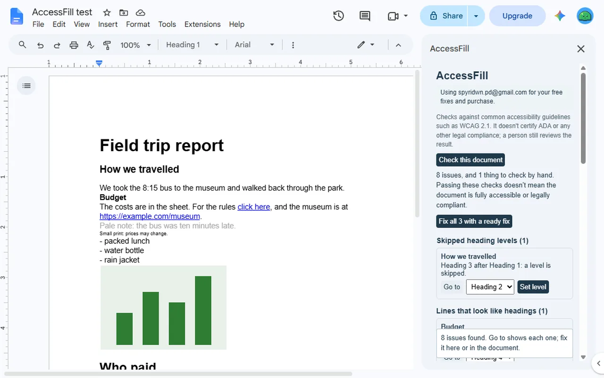
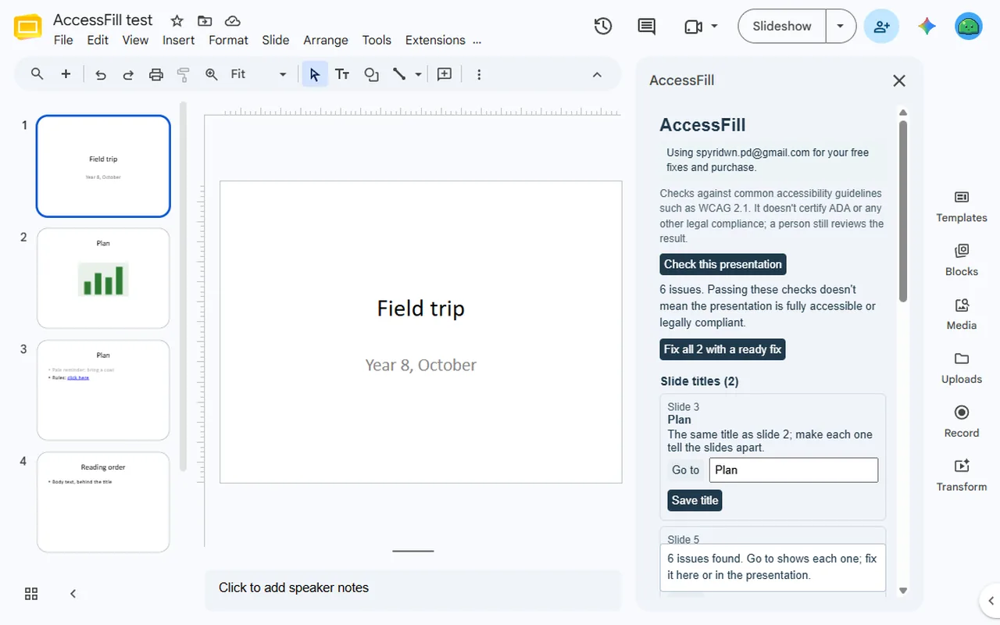
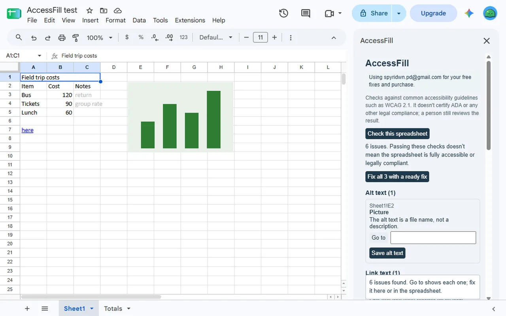

<a href="/addons/">Workspace add-ons</a>

<h1>AccessFill: Accessibility Checker &amp; Alt Text</h1>

Check Google Docs™, Slides™ and Sheets™ for accessibility: alt text, headings, contrast, links. The whole check is free; fix in place. $9 once.

Pro $9.00 once<a class="buy" href="https://workspace.google.com/marketplace/app/accessfill_accessibility_checker_alt_tex/551400700810">Install free</a>

<a href="/privacy/accessfill/">Privacy policy</a> &middot; <a href="/terms/accessfill/">Terms of service</a> &middot; Support: <a href="mailto:spyridwn.pd@gmail.com">spyridwn.pd@gmail.com</a>

AccessFill checks Google Docs™, Google Slides™ and Google Sheets™ against common accessibility
guidelines such as WCAG 2.1, and fixes the issues you choose in place.

- **Alt text**: images with none, or with a file name instead of a description.
- **Headings**: skipped levels, empty headings, and bold lines that should be headings.
- **Links**: "click here" and bare web addresses as link text.
- **Colour contrast** against the real background, with the nearest colour that passes.
- **Slides™**: missing or repeated titles, and titles read after other items. **Sheets™**: header
  rows, merged cells, sheet names. **Docs™**: typed lists, small text, untitled documents.
- **Check by hand**: what Google's editors don't let add-ons read is listed for you to check.
- **Narrow access**: AccessFill only reaches the file you use it in, and uses no AI.

AccessFill checks against common guidelines; it doesn't certify ADA or any other legal compliance,
and passing its checks doesn't mean a file is fully accessible.

## Plans

- **Free**: the whole check, as often as you like, and 5 fixes in total per Google account.
- **AccessFill**: $9 once per Google account for unlimited fixes and Fix all. No subscription.
  Refunds within 14 days. See the [terms](/terms/accessfill/).

**[Install free](https://workspace.google.com/marketplace/app/accessfill_accessibility_checker_alt_tex/551400700810)**

Open it from **Extensions > AccessFill > Check accessibility** in any document, presentation or
spreadsheet.

[Add-on will not open or uses the wrong Google account?](/google-workspace-add-on-wrong-account/)

Google Docs™, Google Slides™ and Google Sheets™ are trademarks of Google LLC. AccessFill is not
affiliated with Google.

[Privacy policy](/privacy/accessfill/) · [Terms of service](/terms/accessfill/) ·
Support: [spyridwn.pd@gmail.com](mailto:spyridwn.pd@gmail.com)
