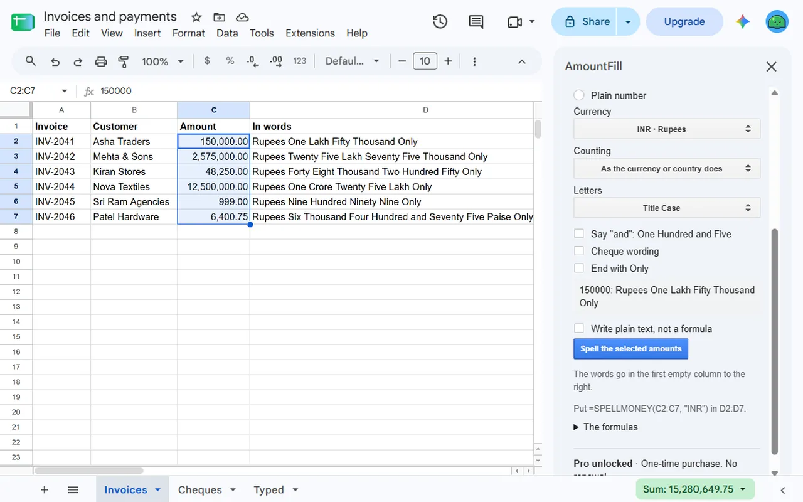
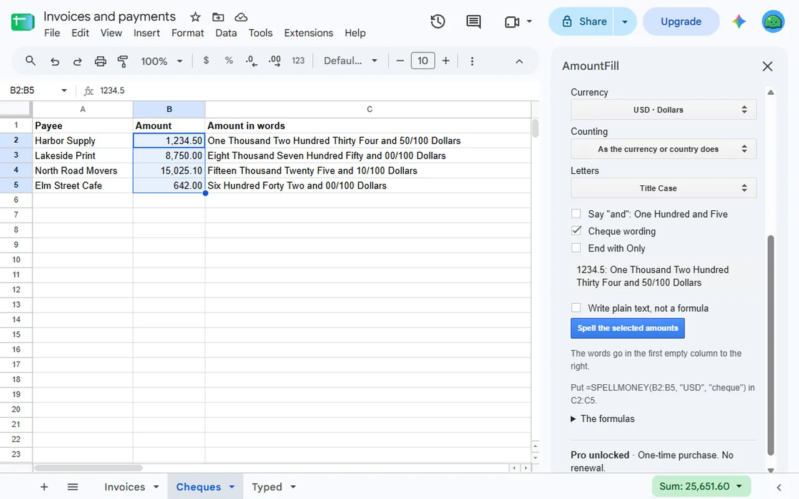
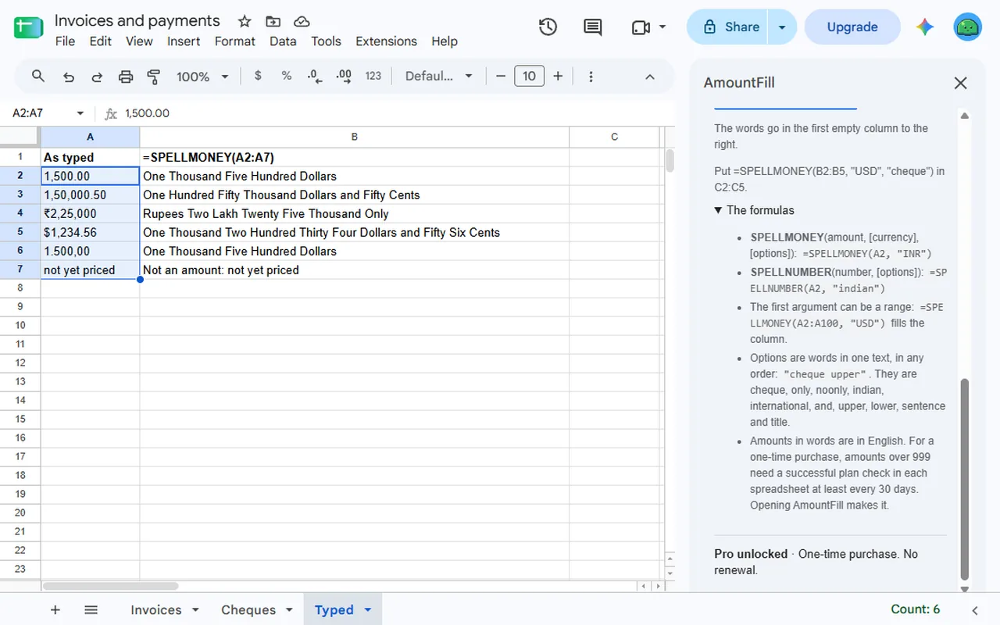

<a href="/addons/">Workspace add-ons</a>

<h1>AmountFill: Spell Number, Money to Words &amp; Rupees</h1>

Spell numbers and money in words for Google Sheets™: rupees in lakh and crore, dollars, euros and more, with cheque wording. Amounts up to 999 free, then $9 once.

Pro $9.00 once<a class="buy" href="https://workspace.google.com/marketplace/app/amountfill_spell_number_money_to_words_r/789591823130">Install free</a>

<a href="/privacy/amountfill/">Privacy policy</a> &middot; <a href="/terms/amountfill/">Terms of service</a> &middot; Support: <a href="mailto:spyridwn.pd@gmail.com">spyridwn.pd@gmail.com</a>

AmountFill is an add-on for Google Sheets™ that turns the amounts in your spreadsheet into words,
for invoices, receipts and cheques: two formulas, and a sidebar that spells a whole column.

PrintFill's QR codes, barcodes and labels stay until the end of 22 December 2026: Extensions >
AmountFill > Open PrintFill (until the end of 22 December 2026).

- `=SPELLMONEY(A2, "INR")` gives Rupees One Lakh Fifty Thousand Only.
- `=SPELLMONEY(A2, "USD", "cheque")` gives One Thousand Two Hundred Thirty Four and 50/100 Dollars.
- `=SPELLNUMBER(A2)` gives One Thousand Five Hundred.

- **Lakh and crore, or million and billion**: as the currency or the spreadsheet's country does, or
  as you choose.
- **36 currencies**: without a code, it follows the symbol typed with the amount, then the
  spreadsheet's country.
- **Works on cells that hold a formula, and on a whole range at once**: `=SPELLMONEY(A2:A100, "USD")`
  fills the column.
- **Reads amounts typed as text**, such as 1,500.00 or ₹1,50,000. Text it cannot read with certainty
  says `Not an amount` in the cell.
- **Upper case, sentence case, "and", "Only" and cheque wording.**
- **The sidebar spells a column**: select the amounts and it writes one live formula, or the words as
  plain text, in the first empty column to the right.

**Good to know.** Words are in English. Amounts go up to 15 digits. An amount with more decimals than
its currency has is rounded. A formula with no currency code keeps the one it had if the spreadsheet's
country changes later. Read the words before you rely on them, above all on a cheque.

## Plans

- **Free**: amounts up to 999, as many as you like, by the whole part of each amount.
- **AmountFill Pro**: $9 once per Google account for amounts of any size. No subscription or renewal.
  Refunds within 14 days. See the [terms](/terms/amountfill/). In each spreadsheet, amounts over 999
  need a successful plan check at least every 30 days; opening AmountFill makes it. Reopening the
  spreadsheet alone does not, and anyone who can open a checked spreadsheet sees its amounts spelled.

**[Install free](https://workspace.google.com/marketplace/app/amountfill_spell_number_money_to_words_r/789591823130)**

Open it from **Extensions > AmountFill** in any spreadsheet.

[Add-on will not open or uses the wrong Google account?](/google-workspace-add-on-wrong-account/)

[Privacy policy](/privacy/amountfill/) · [Terms of service](/terms/amountfill/) · Support:
[spyridwn.pd@gmail.com](mailto:spyridwn.pd@gmail.com)
