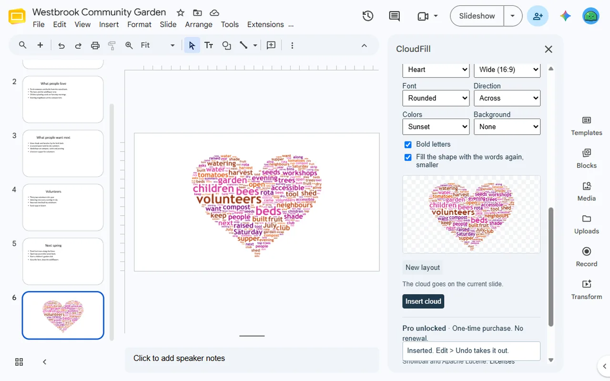
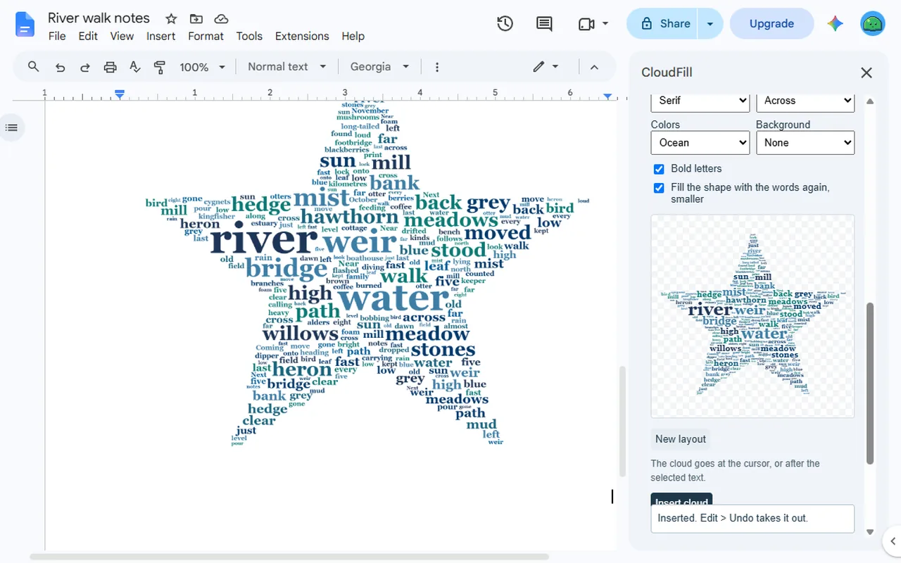
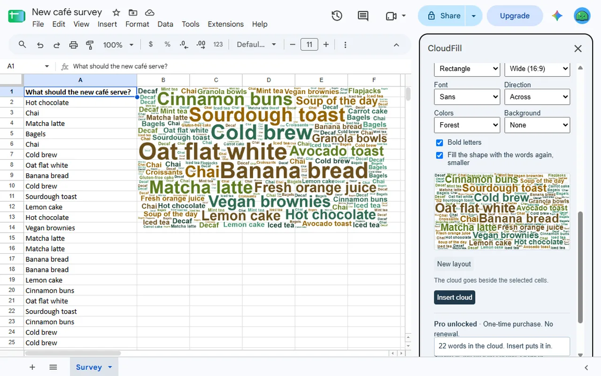

<a href="/addons/">Workspace add-ons</a>

<h1>CloudFill: Word Cloud for Slides™, Docs™ &amp; Sheets™</h1>

Word clouds from the text of a presentation, document or sheet, in a heart, star or other shape, inserted as a picture. Every preview free; 2 clouds free, then $9 once.

Pro $9.00 once<a class="buy" href="https://workspace.google.com/marketplace/app/cloudfill_word_cloud_for_slides_docs_she/782836715301">Install free</a>

<a href="/privacy/cloudfill/">Privacy policy</a> &middot; <a href="/terms/cloudfill/">Terms of service</a> &middot; Support: <a href="mailto:spyridwn.pd@gmail.com">spyridwn.pd@gmail.com</a>

CloudFill is an add-on for Google Slides™, Google Docs™ and Google Sheets™ that makes a word cloud
from the text of your presentation, document or spreadsheet and inserts it there as a picture. It
replaces RandomFill on the same Google Workspace Marketplace listing.

- **Words from the whole file or the selection**: every slide, with the speaker notes if you like;
  every tab of a document; the cells of a sheet, each cell one entry if you like, so answers such
  as "New York" stay whole.
- **Common words left out** in 20 languages, the language detected for you. Keep phrases
  together, leave out words you don't want, choose lower or upper case, and up to 300 words.
- **Shapes**: rectangle, circle, heart, star, cloud or diamond, wide or square, filled with the
  words again, smaller, if you like.
- **Look**: five fonts, words across, some upright or at mixed angles, six colour sets, and a
  transparent, white or dark background.
- **Insert**: on the current slide, at the cursor in a document, or beside the selected cells.
  The picture's alt text names its biggest words. **Edit > Undo** takes it out.

The words are counted and the cloud drawn in your browser. CloudFill sends your text to no AI or
other service, and does not change your text or cells.

## Plans

- **Free**: every preview, unlimited; 2 clouds inserted in total per Google account.
- **CloudFill**: $9 once per Google account for unlimited clouds. No subscription. Refunds within
  14 days. Accounts that bought RandomFill have it already. See the [terms](/terms/cloudfill/).

**[Install free](https://workspace.google.com/marketplace/app/cloudfill_word_cloud_for_slides_docs_she/782836715301)**

Open a presentation, document or spreadsheet and choose **Extensions** > **CloudFill** > **Make a
word cloud**.

[Add-on will not open or uses the wrong Google account?](/google-workspace-add-on-wrong-account/)

[Privacy policy](/privacy/cloudfill/) · [Terms of service](/terms/cloudfill/) · Support:
[spyridwn.pd@gmail.com](mailto:spyridwn.pd@gmail.com)
