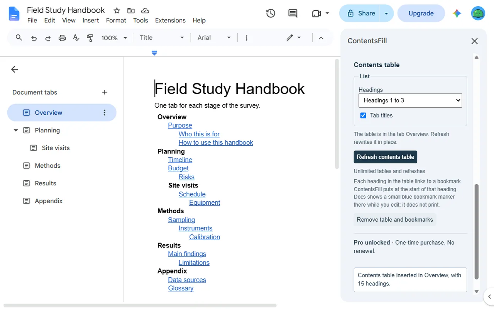
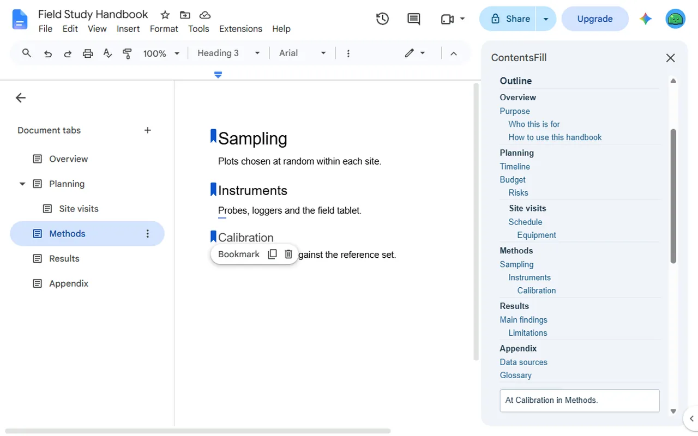
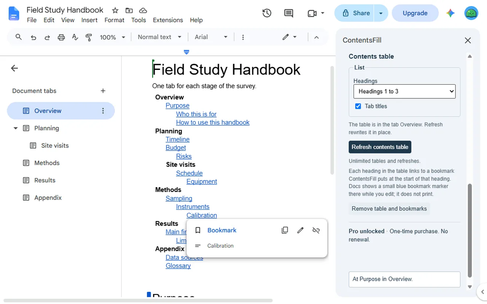

<a href="/addons/">Workspace add-ons</a>

<h1>ContentsFill: Table of Contents (TOC) Across Tabs</h1>

Table of contents across every tab of a Google Docs™ document, each heading linked. Free outline sidebar; 3 tables or refreshes free, then $9 once.

Pro $9.00 once<a class="buy" href="https://workspace.google.com/marketplace/app/contentsfill_table_of_contents_toc_acros/613720786933">Install free</a>

<a href="/privacy/contentsfill/">Privacy policy</a> &middot; <a href="/terms/contentsfill/">Terms of service</a> &middot; Support: <a href="mailto:spyridwn.pd@gmail.com">spyridwn.pd@gmail.com</a>

**On 22 December 2026, ContentsFill becomes ScoreFill: Music Notation & Sheet Music** on the same
Google Workspace Marketplace listing, which writes music on a staff for Google Docs™ and Google
Slides™. The outline and inserting, refreshing and removing contents tables end that day, so use
Remove table and bookmarks before then on any table you would rather not keep. Your tables and
bookmarks stay in your documents until you delete them, and the tables' links keep working, but the
tables no longer refresh. A ContentsFill purchase unlocks ScoreFill; if you would rather have your
money back, write to spyridwn.pd@gmail.com. Your count of free uses, your count of runs and the
billing cache ContentsFill stored for your account are deleted the first time ScoreFill opens. The
table's options and the bookmarks' IDs ContentsFill kept in a document's own storage stay with the
document and do nothing. Your headings and text stay as they are. ScoreFill's free use is 3 new
snippets in total, and Google asks you to agree to one more permission, for Slides, when you first
open it.

ContentsFill is an add-on for Google Docs™ that makes a table of contents for every tab of a
document: each tab and its headings, nested tabs under their parent, every heading linked.

- **Outline sidebar**: every tab and its headings in a sidebar. Click a heading to go to it, in
  whichever tab it is. Free, as often as you like: headings for the first 3 tabs, and every tab
  listed.
- **Linked contents table**: inserted where the cursor is, listing the headings of every tab,
  Heading 1 down to the level you choose, under each tab's title. A click on a heading jumps to it
  in the same browser tab, in whichever document tab it is. After you edit, Refresh rewrites the
  same table in place.
- **Bookmarks at your headings**: in Docs, a link to a heading in another tab goes to a bookmark,
  so ContentsFill puts one at the start of each heading the table lists. Docs shows a small blue
  bookmark marker beside each of them while you edit; the markers do not print. Remove table and
  bookmarks takes out the table and every bookmark ContentsFill added.

Not in this version: heading numbering.

## Plans

- **Free**: the outline with headings for the first 3 tabs, unlimited, and 3 contents tables or
  refreshes in total per Google account.
- **ContentsFill**: $9 once per Google account for unlimited tables and every tab's headings in
  the outline. No subscription. Refunds within 14 days. See the [terms](/terms/contentsfill/).

**[Install free](https://workspace.google.com/marketplace/app/contentsfill_table_of_contents_toc_acros/613720786933)**

Open it from **Extensions > ContentsFill**
in any document.

[Add-on will not open or uses the wrong Google account?](/google-workspace-add-on-wrong-account/)

[Privacy policy](/privacy/contentsfill/) · [Terms of service](/terms/contentsfill/) · Support:
[spyridwn.pd@gmail.com](mailto:spyridwn.pd@gmail.com)
