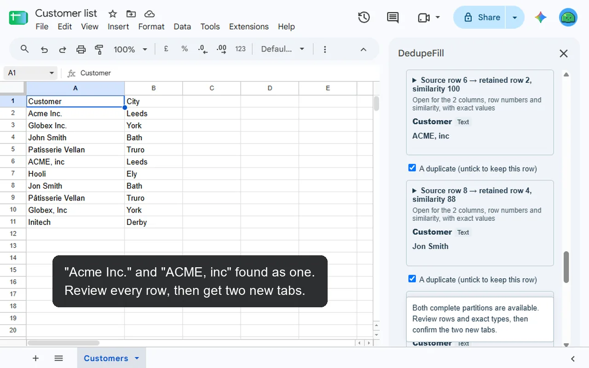
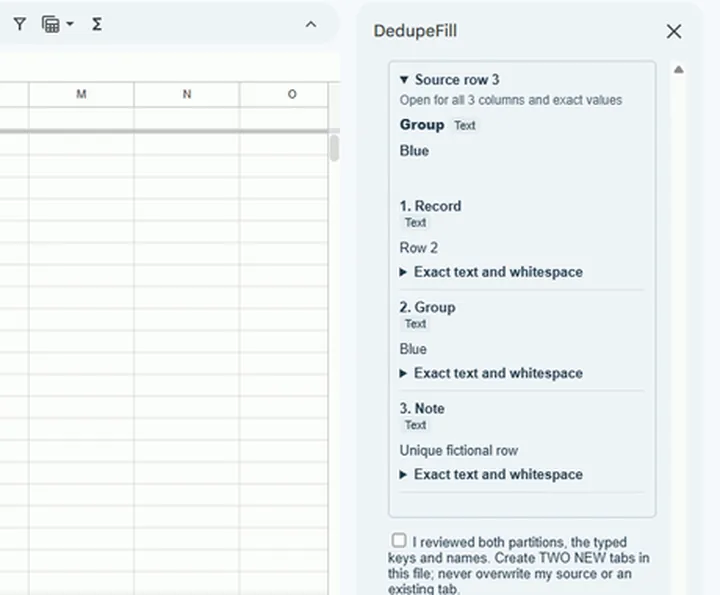
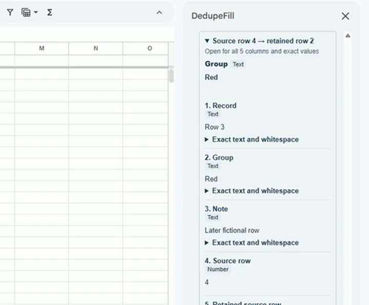
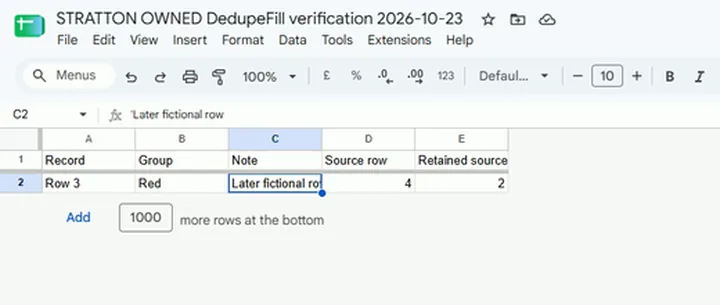
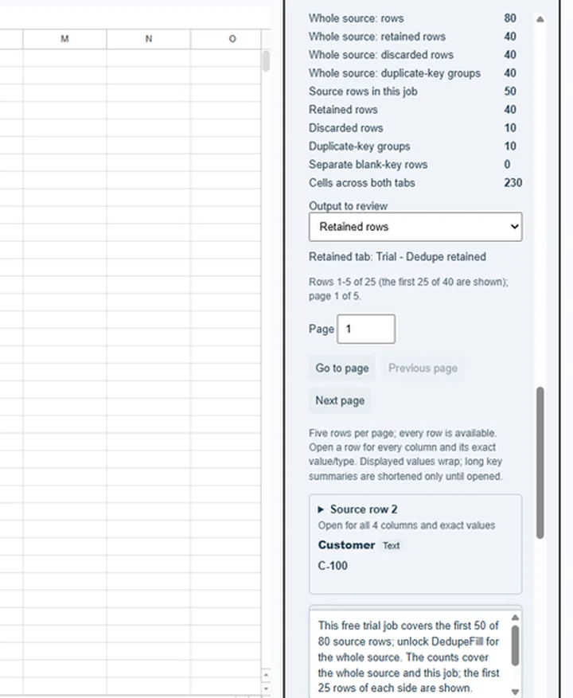
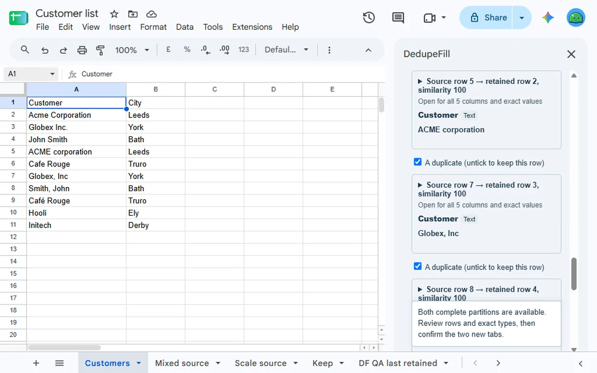

<a href="/addons/">Workspace add-ons</a>

<h1>DedupeFill: Find &amp; Remove Similar Duplicates</h1>

Find and remove duplicate rows in Google Sheets™, exact or similar (typos, case, accents, spacing), into new retained and discarded tabs. Review every row first; your source stays unchanged.

Pro $9.00 once<a class="buy" href="https://workspace.google.com/marketplace/app/dedupefill_find_remove_similar_duplicate/627456661041">Install free</a>

<a href="/privacy/dedupefill/">Privacy policy</a> &middot; <a href="/terms/dedupefill/">Terms of service</a> &middot; Support: <a href="mailto:spyridwn.pd@gmail.com">spyridwn.pd@gmail.com</a>

Review duplicate rows in Google Sheets™ before creating two new tabs: the rows you keep, and the rows you discard
with references to their retained source rows. Your source stays intact.

**Two paired jobs free in total, each over the first 50 source rows; $9 once for more. Refunds
within 14 days.** A free Preview counts the whole source and shows the first 25 rows of each
side, and recognized retries are free. Existing users keep their current free allowance. No
subscription or automatic renewal; technical and Google service limits apply.

**[Install free](https://workspace.google.com/marketplace/app/dedupefill_find_remove_similar_duplicate/627456661041)**

## Choose what counts as a duplicate

- Select a range with headings and the columns that identify matching rows.
- Or choose similar text: "Acme Inc." and "ACME, inc", "Café Rouge" and "Cafe Rouge". Set
  how similar (50 to 100), and whether word order and company words such as Inc and Ltd
  count. Each discarded row shows its similarity; untick any that is not a duplicate.
- Choose the first or last source row to keep. This means row order, not newest date.
- Review retained and discarded rows, their counts and source-row references before creating
  both output tabs. Optional fictional practice data lets you try the workflow first.

Exact keys use typed values: case and spaces matter, and text `00123` differs from numeric
`123` displayed as `00123`. Similar text compares the cells as displayed; numbers must be
the same, so "Unit 12" is not "Unit 13". Rows are never merged. Blank-key rows
need explicit approval to keep each separately. DedupeFill refuses date-valued keys, source errors and ambiguous error-looking text.
Selected hidden and filtered rows participate.

## Keep a snapshot of both decisions

All original columns survive in the appropriate output. The discarded report adds original
and retained source-row numbers, and with similar text each row's similarity, so conflicting non-key values remain available for review.
Calculated values and number formats are copied; formulas become results and literal text
stays text. Fonts/layout and source annotations are not copied; Sheets may detect plain URLs
normally. Later source changes do not update the outputs. Both tabs use the spreadsheet's
existing sharing permissions.

Stop after the current request; a retry of the same unchanged job continues it without using another free job.

## Supported bounds

Select up to 5,000 data rows plus one heading row, up to 20 source columns and up to 10
key columns. The two outputs together must fit 100,000 cells, including both heading rows
and the discarded report's two added source-row reference columns (with similar text, also its similarity column). These limits apply jointly;
not every maximum-width input fits the paired-output cap. Oversized jobs refuse rather than
silently dropping rows. Additional text safeguards and Google service limits apply to free
and paid jobs.

Jobs near these limits can take several minutes; DedupeFill works in steps and shows its progress.

## When a free method is enough

For ordinary cleanup, duplicate your tab and use
[Data cleanup → Remove duplicates](https://support.google.com/docs/answer/6325535?hl=en).
[UNIQUE](https://support.google.com/docs/answer/10522653?hl=en) also returns unique rows.
DedupeFill is for reviewing a paired retained/discarded result inside Sheets; these free
methods may be enough if you do not need that report. Google's matching rules can differ.
They match exact values only; DedupeFill also finds rows that differ by a typo, case,
accents, spacing or punctuation.

## Access and billing

DedupeFill accesses only the spreadsheet where you use it. Google's services do the processing;
no AI or external spreadsheet-processing service receives your rows. Stripe receives billing
email and payment information, not spreadsheet contents. The account shown in the sidebar owns
the free allowance and purchase; operations check that account.

Google Sheets™ is a trademark of Google LLC.

[Privacy policy](/privacy/dedupefill/) · [Terms of service](/terms/dedupefill/) · Support:
[spyridwn.pd@gmail.com](mailto:spyridwn.pd@gmail.com)
