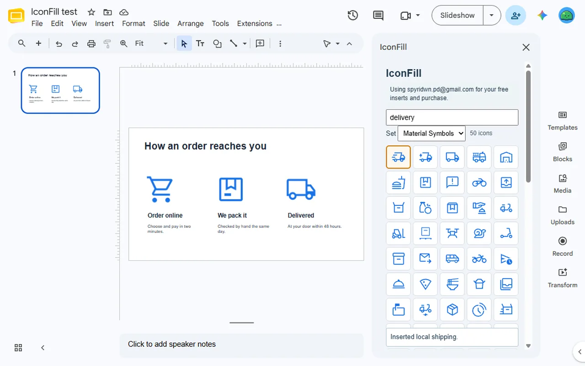
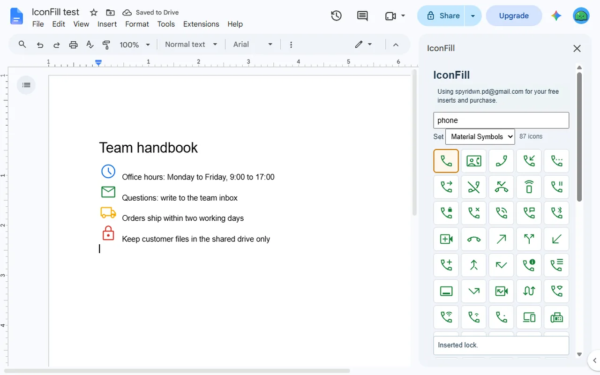
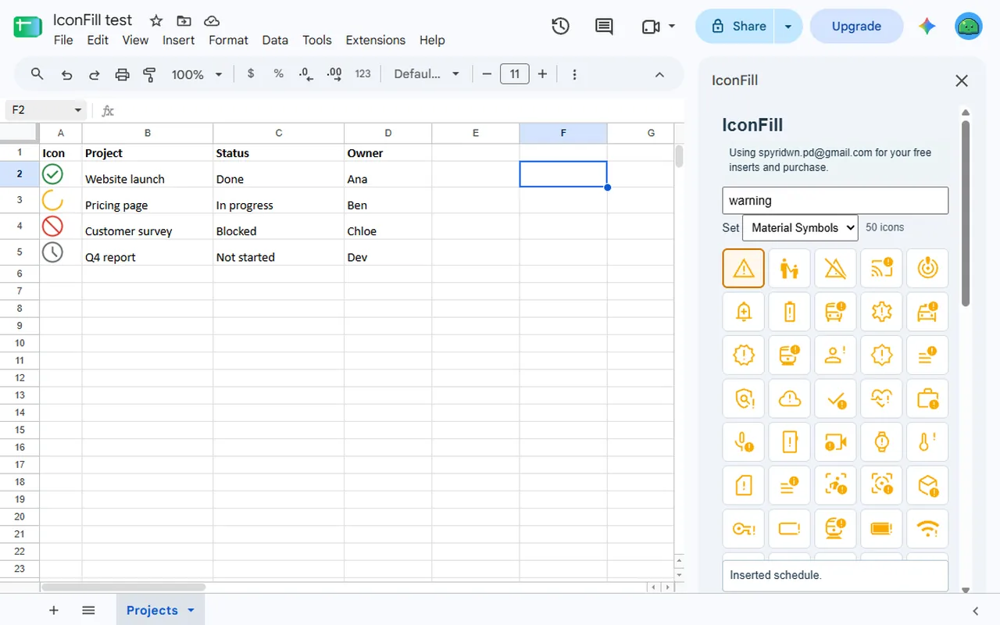

<a href="/addons/">Workspace add-ons</a>

<h1>IconFill: Insert Icons in Slides™, Docs™, Sheets™</h1>

Icons for Google Slides™, Docs™ and Sheets™: 5,800 open-source icons, free for commercial use, any color, inserted free. On shapes or for a list, $9 once.

Pro $9.00 once<a class="buy" href="https://workspace.google.com/marketplace/app/iconfill_insert_icons_in_slides_docs_she/341237270979">Install free</a>

<a href="/privacy/iconfill/">Privacy policy</a> &middot; <a href="/terms/iconfill/">Terms of service</a> &middot; Support: <a href="mailto:spyridwn.pd@gmail.com">spyridwn.pd@gmail.com</a>

IconFill is an add-on that puts clean, consistent icons into Google Slides™, Google Docs™ and
Google Sheets™ from one sidebar.

- **Search that finds the icon**: type what you mean ("money", "team", "growth", "idea"). IconFill
  searches names and tags, understands plurals and everyday words, and shows the best matches
  first.
- **Any color**, and three styles: Material Symbols Outlined, Rounded or Sharp, filled or not;
  Lucide with the line weight you choose.
- **5,800 open-licensed icons**: Material Symbols by Google (Apache License 2.0) and Lucide (ISC
  License, partly MIT from Feather) are open-source sets free for personal and commercial use under
  their [licenses](/iconfill/licenses/), which are also in the add-on. IconFill's price pays for the
  add-on, not the icons.
- **One click to insert**: in the middle of the current slide, at the cursor in a document, or at
  the selected cell in a spreadsheet (over the cells, or inside an empty cell).
  In Docs and Sheets the icon can match the text's size.
- **Icons on shapes** (Pro): a circle, a rounded square or a ring behind the icon, in a color you
  choose, inserted as one image.
- **Icons for a list** (Pro): write one line for each icon, such as an agenda or the steps of a
  process, and IconFill finds an icon for each, all from one set and in one look. Take another match
  where you like and insert each with a click.
- **Narrow access**: IconFill only reaches the file you use it in. Your searches and lists stay in
  your browser.

Google currently can't open documents that use Docs' own captions (Insert > Page elements > Inline
caption) for add-ons built on Apps Script, like IconFill. In those, IconFill stops with a message.

## Plans

- **Free**: any number of icons inserted, in any color, style and size. Shapes and icons for a list
  are previewed free.
- **IconFill Pro**: $9 once per Google account to insert icons on shapes and icons for a list. No
  subscription. Refunds within 14 days. See the [terms](/terms/iconfill/).

**[Install free](https://workspace.google.com/marketplace/app/iconfill_insert_icons_in_slides_docs_she/341237270979)**

Open it from **Extensions > IconFill** in
any presentation, document or spreadsheet.

[Add-on will not open or uses the wrong Google account?](/google-workspace-add-on-wrong-account/)

Google Slides™, Google Docs™ and Google Sheets™ are trademarks of Google LLC. IconFill is not
affiliated with Google. Material Symbols are licensed under the Apache License 2.0, Lucide under
the ISC License.

[Privacy policy](/privacy/iconfill/) · [Terms of service](/terms/iconfill/) ·
[Icon licenses](/iconfill/licenses/) · Support: [spyridwn.pd@gmail.com](mailto:spyridwn.pd@gmail.com)
