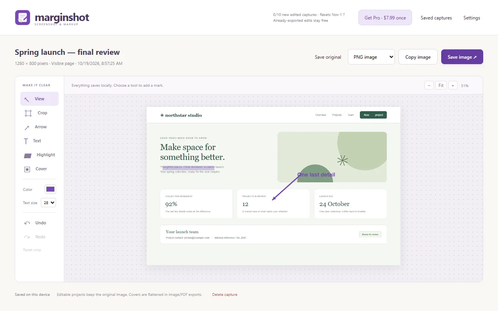
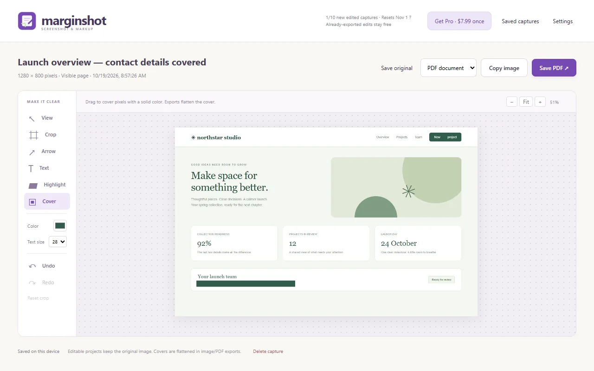
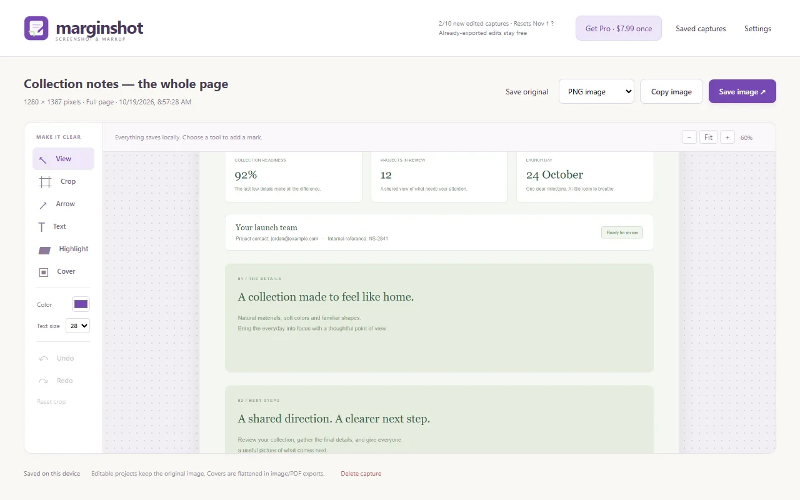
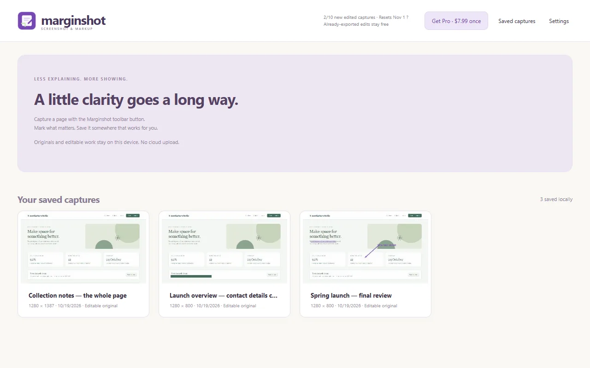

<a href="/extensions/">Chrome extensions</a>

<h1>Marginshot: Screenshot, Annotate &amp; Markup</h1>

Annotate a screenshot of a page or area: arrows, text, crop and solid covers for private details. Saved locally. One-time Pro.

Pro $7.99 once<a class="buy" href="https://chromewebstore.google.com/detail/marginshot-screenshot-ann/khiednhplkpcpgmfenmkgggkmhklbkip">Add to Chrome</a>

<a href="/privacy/marginshot/">Privacy policy</a> &middot; <a href="/terms/marginshot/">Terms of service</a> &middot; Support: <a href="mailto:spyridwn.pd@gmail.com">spyridwn.pd@gmail.com</a>

Capture a web page, point out what matters and save the result on your computer. Marginshot is
available free from the Chrome Web Store.

Choose the visible page, drag around an area or capture a full page. Crop the image, add arrows,
text and highlights, or cover details you do not want in the exported result. Copy an image or
save it as PNG, JPEG or PDF. Screenshots and editable projects stay local; there is no cloud
upload or hosted-sharing service. Optional daily action totals are off unless you choose to
share them; they contain no screenshots, page information or installation identifier.

Free includes unlimited original captures and ten new edited captures per local calendar month.
A capture uses an allowance on its first successful edited copy or export. Exporting that edited
capture again, changing format or making more edits does not use another allowance. Failed
attempts do not spend it. Marginshot Pro removes the allowance for **$7.99 once**.

An editable project keeps the original image, including pixels under covers. Image and PDF
exports flatten the current edits. Review the exported result before sharing it; use Delete
capture or Clear saved captures to remove local editable projects you no longer want.

Full-page capture scrolls the main page while its tab remains active. Infinite feeds, inner
scrolling areas, protected pages and very large pages may need a smaller capture. Keep an
exported copy of work you want to retain: uninstalling the extension or losing its browser
profile can remove saved projects.

[How to take a full page screenshot in Chrome](/marginshot/full-page-screenshot-chrome/) covers
Chrome's built-in command, free alternatives and Marginshot's capture and markup steps.
[How to redact a screenshot](/marginshot/redact-a-screenshot/) explains solid covers against blur
and highlights, free redaction tools and what Marginshot's editable projects keep.

[Terms and refunds](/terms/marginshot/) · [Privacy policy](/privacy/marginshot/).
Support: [spyridwn.pd@gmail.com](mailto:spyridwn.pd@gmail.com).
