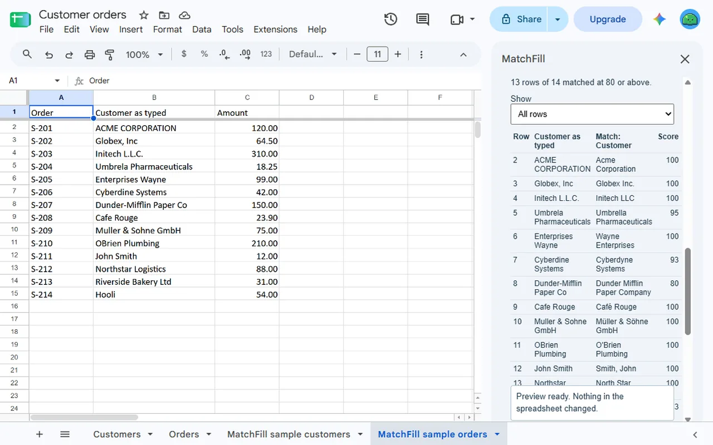
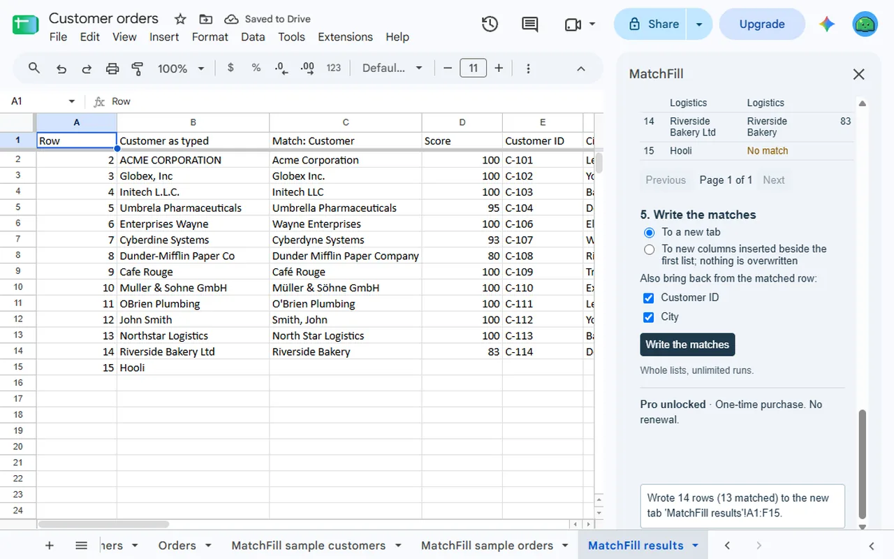
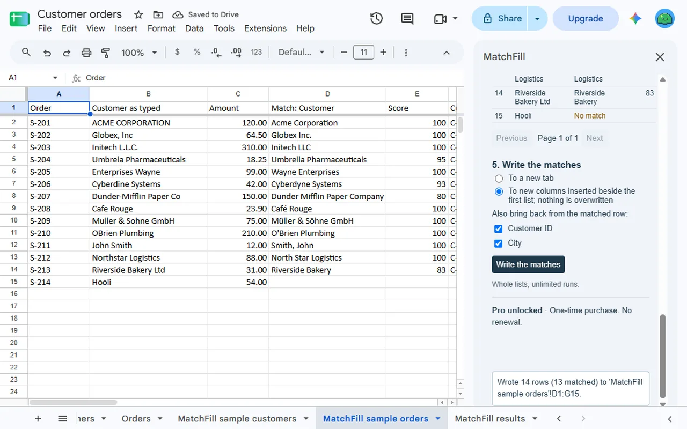
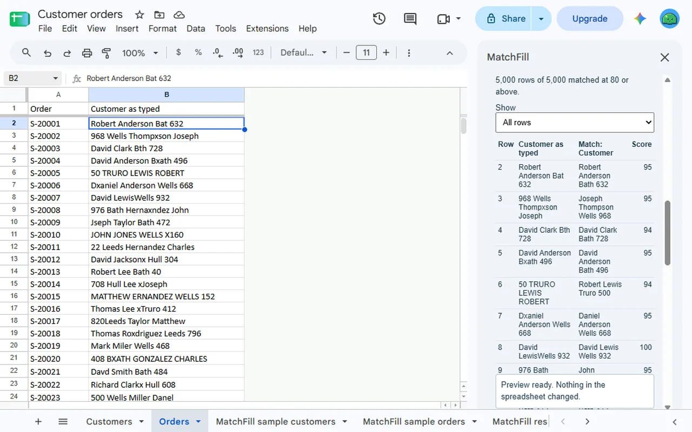

<a href="/addons/">Workspace add-ons</a>

<h1>MatchFill: Match Similar Text Across Two Lists</h1>

Fuzzy match two lists in Google Sheets™: names typed with slips, in other case or word order, find their closest match, with a score. Preview free; 3 free runs, then $9 once.

Pro $9.00 once<a class="buy" href="https://workspace.google.com/marketplace/app/matchfill_match_similar_text_across_two/560003758784">Install free</a>

<a href="/privacy/matchfill/">Privacy policy</a> &middot; <a href="/terms/matchfill/">Terms of service</a> &middot; Support: <a href="mailto:spyridwn.pd@gmail.com">spyridwn.pd@gmail.com</a>

**Soon, MatchFill becomes StyleFill: Custom Styles for Google Docs™** on the same Google Workspace
Marketplace listing, which makes your own paragraph and character styles in Google Docs™. Matching
lists in Google Sheets™ ends then. Matching similar text is in [DedupeFill](/dedupefill/), which finds
similar rows by the same scoring. The tabs and columns MatchFill added stay in your spreadsheets until
you delete them. A match shown in the sidebar but not written is not kept, so write any you want
before then. A MatchFill purchase unlocks StyleFill; if you would rather have your money back, write
to spyridwn.pd@gmail.com. Your free-run count and record of your latest run, your count of runs and
the billing cache MatchFill stored for your account are deleted the first time StyleFill opens. Your
lists stay in your spreadsheets. StyleFill starts with its own 2 free styles.

MatchFill is an add-on for Google Sheets™ that fuzzy matches one list against another: each row
of the first list gets the closest row of the second, with a score from 0 to 100, so names typed
in different ways still find each other.

- **What counts as the same**: case, accents, spacing and punctuation never count ("ACME CORP."
  is "Acme Corp", "Café" is "Cafe"); each typed slip lowers the score. Choose the lowest score
  that counts as a match. Word order ("Smith, John" is "John Smith") and company words such as
  Inc, Ltd, LLC, Corp and The can be ignored too.
- **Preview, then write**: the preview shows every row with its match and score, or no match,
  and changes nothing. Then write the matches to a new tab, or to new columns inserted beside the
  first list, bringing back any other columns of the matched row, such as an ID or a price.
  Nothing is written over your cells.
- **Near-duplicates**: choose the same list twice and each row gets its closest other row.
- **Sample tabs**: no lists to try it on? Create sample tabs adds two tabs of fictional customers
  and orders.

Lists of up to 5,000 rows and 26 columns each. Matches are a judgement of similar text, not of
identity: check them before you rely on them.

## Plans

- **Free**: the preview over whole lists, always, and 3 runs in total per Google account, each on
  the first 50 rows of each list.
- **MatchFill**: $9 once per Google account for whole lists. No subscription. Refunds within
  14 days. See the [terms](/terms/matchfill/).

**[Install free](https://workspace.google.com/marketplace/app/matchfill_match_similar_text_across_two/560003758784)**

Open it from **Extensions > MatchFill** in any spreadsheet.

[Add-on will not open or uses the wrong Google account?](/google-workspace-add-on-wrong-account/)

[Privacy policy](/privacy/matchfill/) · [Terms of service](/terms/matchfill/) · Support:
[spyridwn.pd@gmail.com](mailto:spyridwn.pd@gmail.com)
