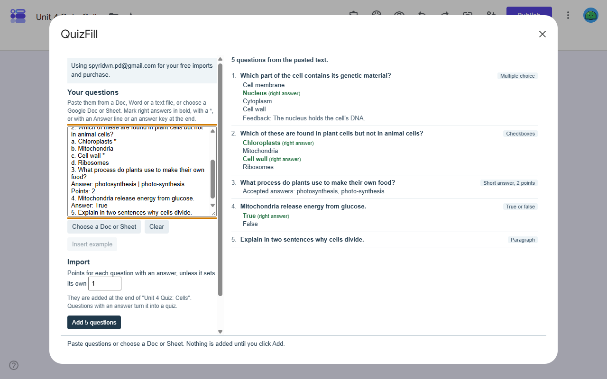
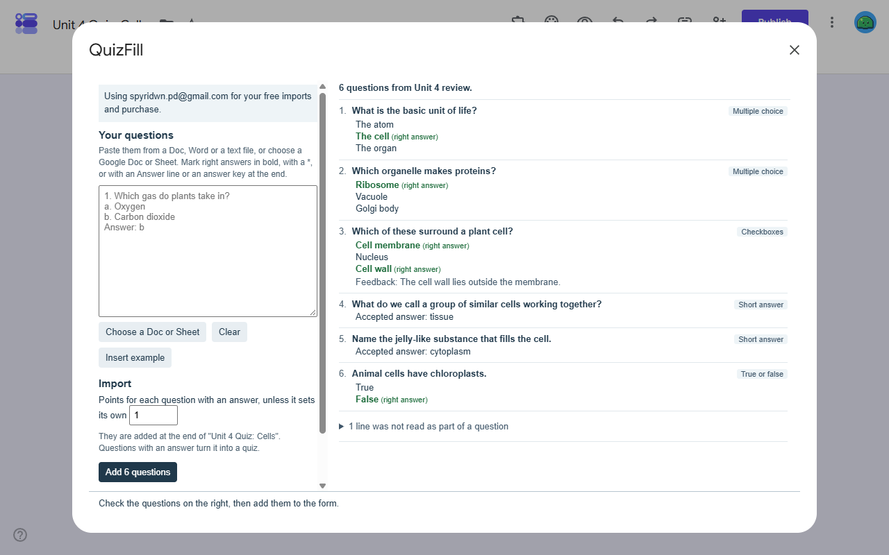
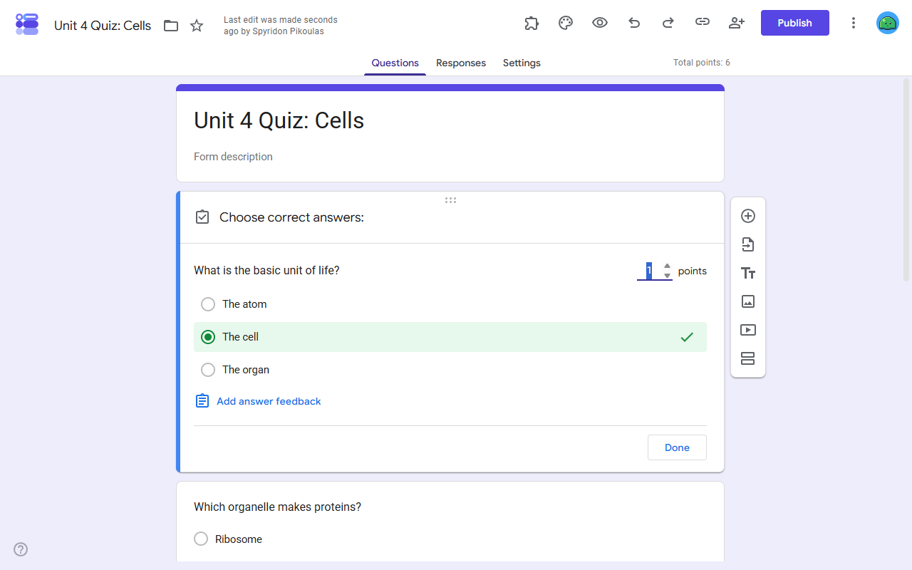

<a href="/addons/">Workspace add-ons</a>

<h1>QuizFill: Import Quiz Questions with Answer Key</h1>

Quiz import for Google Forms™: questions from a Doc™, a Sheet™, a Word file or a paste, with the answer key, points and feedback. 200 questions free in total, then $9 once.

Pro $9.00 once<a class="buy" href="https://workspace.google.com/marketplace/app/quizfill_import_quiz_questions_with_answ/282960420572">Install free</a>

<a href="/privacy/quizfill/">Privacy policy</a> &middot; <a href="/terms/quizfill/">Terms of service</a> &middot; Support: <a href="mailto:spyridwn.pd@gmail.com">spyridwn.pd@gmail.com</a>

QuizFill is an add-on for Google Forms™ that turns the questions you already wrote into a quiz,
with the answer key, points and feedback set. Your questions go in word for word: QuizFill reads
them, it does not write them.

- **Paste or choose a file**: paste questions, choose a Word (.docx), Excel (.xlsx), CSV or text
  file on your computer, or choose one Google Docs™ document or Google Sheets™ spreadsheet. QuizFill
  reads numbered questions with lettered options, Word's own numbered lists, right answers in bold
  or marked with `*`, `Answer:` lines, an answer key at the end, `Points:` and `Feedback:` lines,
  and the Aiken and Respondus formats. In a sheet, or a table in Word: a Question column, option
  columns A, B, C and an Answer column. A file on your computer is read in your browser and not
  uploaded; only the questions you add go to your form, through Google's Apps Script.
- **Preview first**: every question as QuizFill read it, with its type, right answers, points and
  feedback, before anything is added. A note says where something needs a look, such as a question
  whose picture is left out, and lines that were not read are listed. The preview is free.
- **A real quiz**: multiple choice, checkboxes, true/false, short answer and paragraph questions,
  added at the end of the open form, with right answers marked, points set, and right and wrong
  feedback. Short-answer keys too: Forms asks you to choose the form once, then QuizFill adds them.
- **Only the form and the file you choose**: QuizFill works in the form you open it in and reads
  only the file you choose. It has no access to the rest of your Drive, and sends your questions to
  no AI or other service.

Not in this version: pictures in questions, and dropdown, linear scale and grid questions.

## Plans

- **Free**: the preview, unlimited, and 200 questions in total per Google account, in imports of any
  length.
- **QuizFill**: $9 once per Google account for unlimited questions. No subscription. Refunds within
  14 days. See the [terms](/terms/quizfill/).

**[Install free](https://workspace.google.com/marketplace/app/quizfill_import_quiz_questions_with_answ/282960420572)**

Open a form and choose the **Add-ons**
icon > **QuizFill** > **Import questions**.

[Add-on will not open or uses the wrong Google account?](/google-workspace-add-on-wrong-account/)

[Privacy policy](/privacy/quizfill/) · [Terms of service](/terms/quizfill/) · Support:
[spyridwn.pd@gmail.com](mailto:spyridwn.pd@gmail.com)
