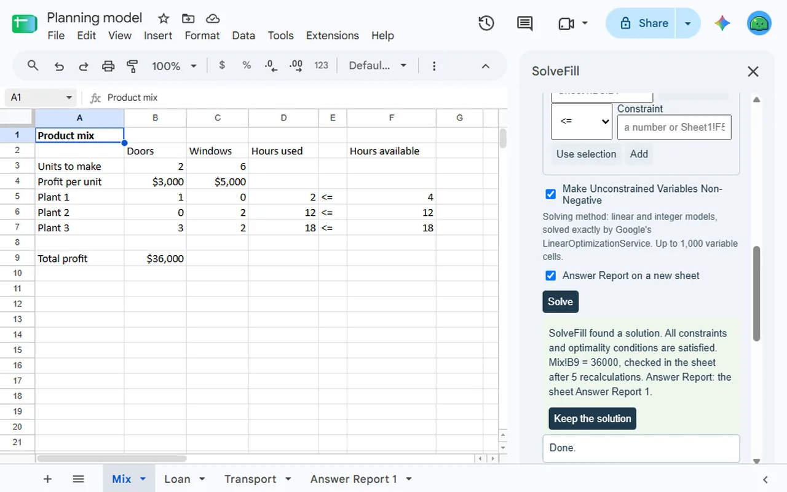
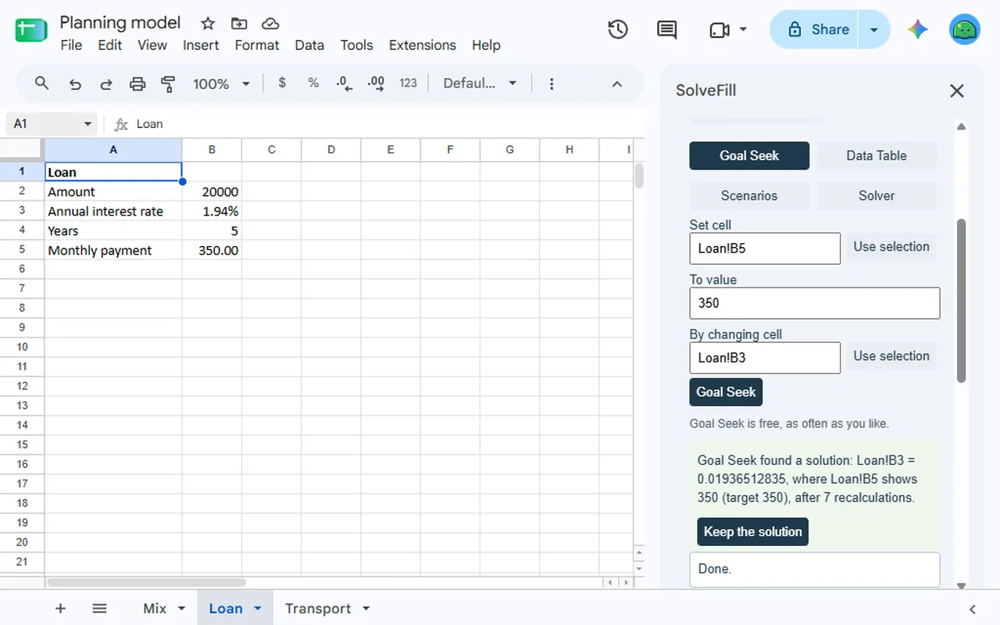
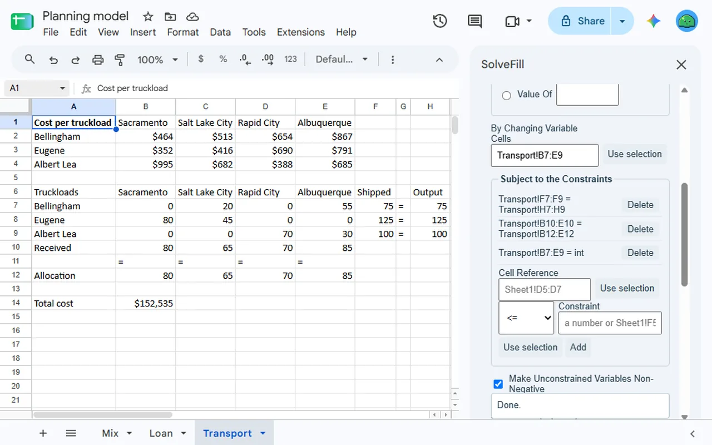
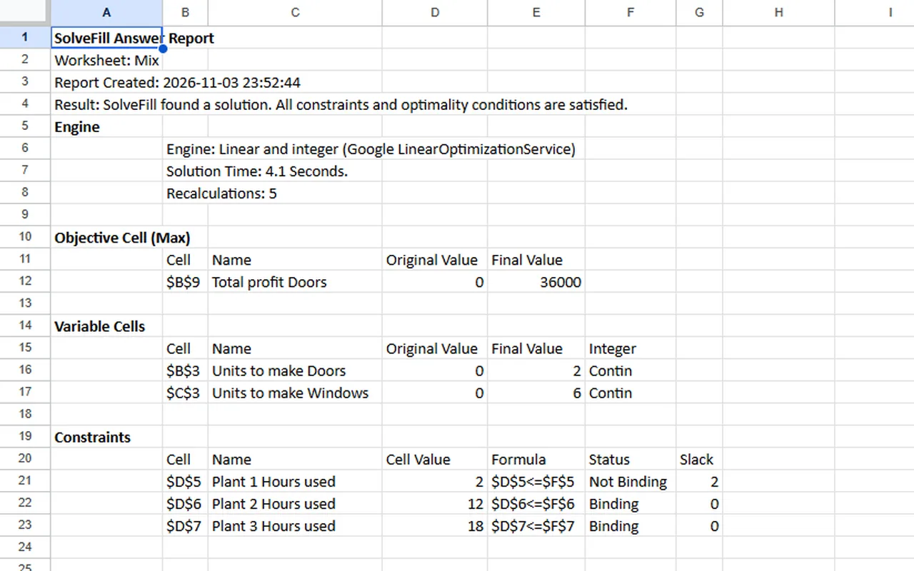
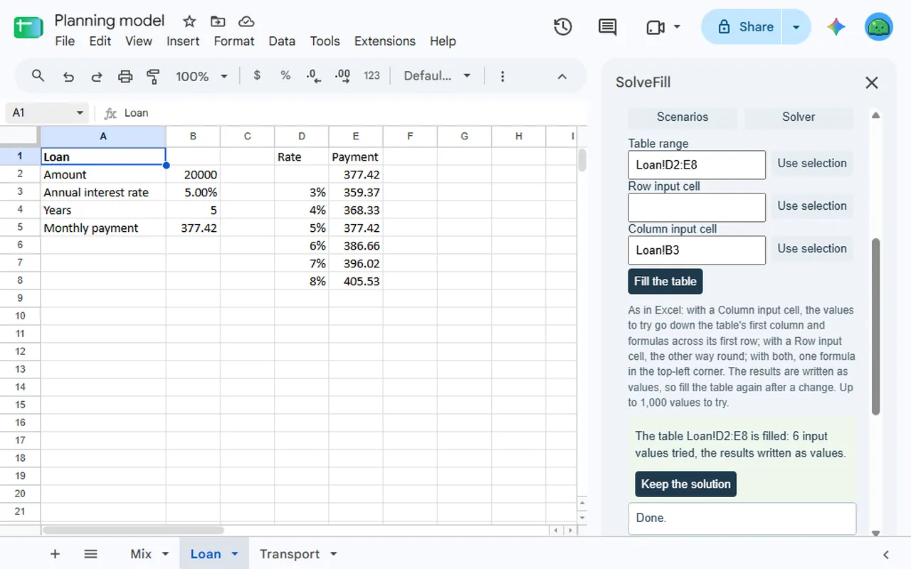
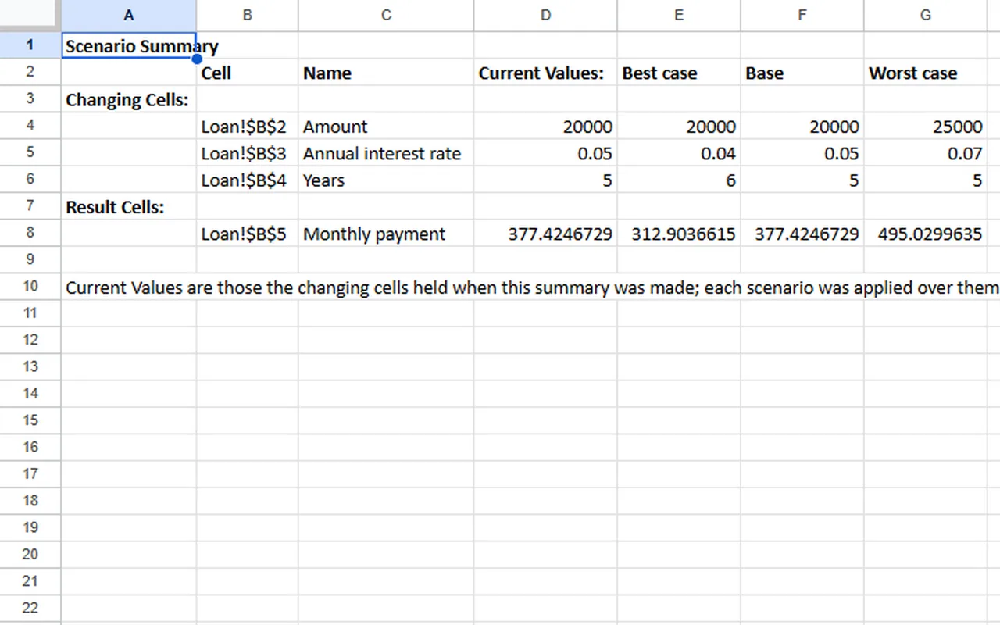

<a href="/addons/">Workspace add-ons</a>

<h1>SolveFill: What-If Analysis, Goal Seek &amp; Solver</h1>

What-If Analysis for Sheets™: Goal Seek, data tables, scenarios and a linear and integer Solver, laid out like Excel's. Every answer checked in your sheet. Goal Seek and scenarios are free.

Pro $9.00 once<a class="buy" href="https://workspace.google.com/marketplace/app/solvefill_whatif_analysis_goal_seek_solv/205852571604">Install free</a>

<a href="/privacy/solvefill/">Privacy policy</a> &middot; <a href="/terms/solvefill/">Terms of service</a> &middot; Support: <a href="mailto:spyridwn.pd@gmail.com">spyridwn.pd@gmail.com</a>

SolveFill is an add-on for Google Sheets™ with Excel-style What-If Analysis: Goal Seek, data tables,
scenarios and a solver for linear and integer models, using the fields of the Goal Seek, Data Table,
Scenario Manager and Solver dialogs in Microsoft Excel.

- **Goal Seek**: make a formula cell show the value you want by changing one input cell, usually in
  a handful of recalculations. Free, as often as you like.
- **Data tables**: see what a formula gives for each value of one input, or each pair of values of
  two, laid out as in Excel. SolveFill tries each value in your sheet and writes the results into
  the table as values. Up to 1,000 values per table.
- **Scenarios**: save named sets of values for your changing cells, show any of them in the sheet,
  and make a Scenario Summary on a new sheet with each changing and result cell under each scenario.
  Saving and showing scenarios is free.
- **Linear and integer solver**: maximize, minimize or reach a value with up to 1,000 variable
  cells, constraints with <=, = and >=, and whole-number (int) or yes/no (bin) variables. Models
  are solved by Google's LinearOptimizationService inside Apps Script, so your spreadsheet's
  contents never leave Google.
- **Every answer checked**: SolveFill writes the answer, recalculates your sheet and checks every
  constraint and the objective before showing it. A model that is not linear is named by its cell
  and left as it was. A data table whose formulas would read its own results is left as it was.
- **Your values come back if you want them**: keep the solution, the table or the scenario shown, or
  restore your original values. An optional Answer Report on a new sheet shows each constraint's
  status and slack.

Not in this version: nonlinear models, the Sensitivity and Limits reports.

## Plans

- **Free**: Goal Seek and scenarios, unlimited, and 3 runs in total per Google account, each a
  solve, a data table or a Scenario Summary. A run that finds no answer, and Insert example's ready
  model, use none.
- **SolveFill**: $9 once per Google account for unlimited runs. No subscription. Refunds within
  14 days. See the [terms](/terms/solvefill/).

**[Install free](https://workspace.google.com/marketplace/app/solvefill_whatif_analysis_goal_seek_solv/205852571604)**

Open it from **Extensions > SolveFill** in
any spreadsheet.

[Add-on will not open or uses the wrong Google account?](/google-workspace-add-on-wrong-account/)

Microsoft and Excel are trademarks of Microsoft Corporation. SolveFill is not affiliated with,
sponsored or endorsed by Microsoft.

[Privacy policy](/privacy/solvefill/) · [Terms of service](/terms/solvefill/) · Support:
[spyridwn.pd@gmail.com](mailto:spyridwn.pd@gmail.com)
