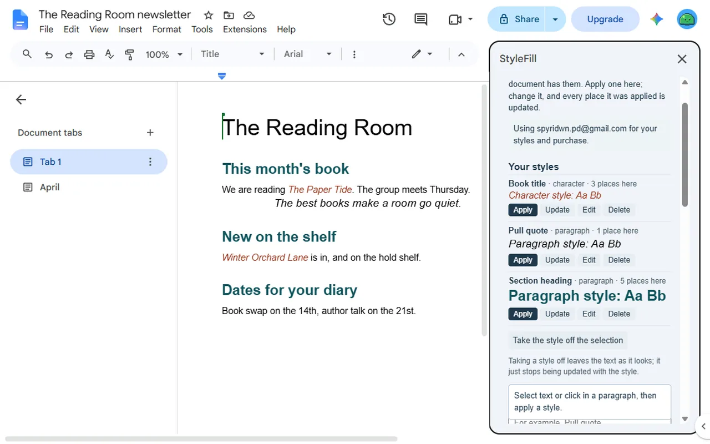
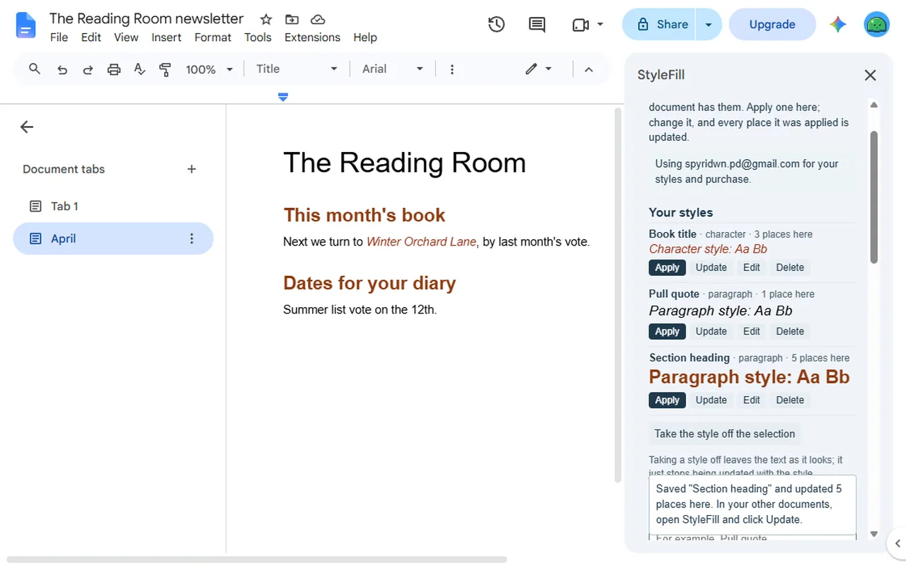
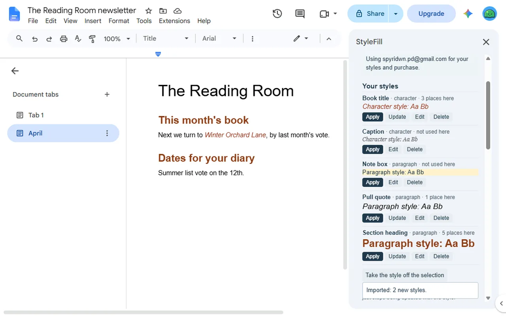

<a href="/addons/">Workspace add-ons</a>

<h1>StyleFill: Custom Styles for Google Docs™</h1>

Your own paragraph and character styles for Google Docs™, kept with your account for every document. Change a style and update it everywhere. 2 styles free, then $9 once.

Pro $9.00 once<a class="buy" href="https://workspace.google.com/marketplace/app/stylefill_custom_styles_for_google_docs/560003758784">Install free</a>

<a href="/privacy/stylefill/">Privacy policy</a> &middot; <a href="/terms/stylefill/">Terms of service</a> &middot; Support: <a href="mailto:spyridwn.pd@gmail.com">spyridwn.pd@gmail.com</a>

StyleFill is an add-on for Google Docs™ that gives you your own paragraph and character styles.
Make one from text formatted the way you want, apply it from the sidebar, and change it later:
every place it was applied in the document is updated. Your styles are kept with your Google
account, so every document you open has them.

- **Make a style from your text**: select a paragraph or some words, name the style, and StyleFill
  takes their font, size, colors, bold, italic, underline and strikethrough. A paragraph style
  also takes the alignment, line spacing, space above and below, indents and outline level.
- **Apply it from the sidebar**: a paragraph style to the paragraphs you select, a character style
  to the selected words.
- **Change it, update everywhere**: edit a style's settings or take them again from the selection,
  and every place it was applied is updated, in every tab of the document. In your other
  documents, open StyleFill and click Update.
- **In every document**: your styles go with your Google account, not with one document.
- **Share a set**: export your styles as a small text file, and import a set from a colleague.

**Good to know.** Text you copy, cut and paste, or paste in from another document, drops out of
its style: Update does not reach it, so apply the style to it again. Press Enter inside a paragraph
with a paragraph style and only the first part keeps the style. Text typed at the very start of a
paragraph, before styled words, stays out of their style. Text added right after styled words that
looks exactly like them joins them at the next update. Docs' own Styles menu lists only Docs'
styles, so StyleFill's are applied from its sidebar. Paragraph borders are not part of a style.

## Plans

- **Free**: 2 styles in total per Google account, made or imported. Deleting a style does not give
  it back. Applying, editing and updating styles are always free.
- **StyleFill**: $9 once per Google account for unlimited styles. No subscription. Refunds within
  14 days. See the [terms](/terms/stylefill/).

**[Install free](https://workspace.google.com/marketplace/app/stylefill_custom_styles_for_google_docs/560003758784)**

Open it from **Extensions > StyleFill** in any document.

[Add-on will not open or uses the wrong Google account?](/google-workspace-add-on-wrong-account/)

[Privacy policy](/privacy/stylefill/) · [Terms of service](/terms/stylefill/) · Support:
[spyridwn.pd@gmail.com](mailto:spyridwn.pd@gmail.com)
