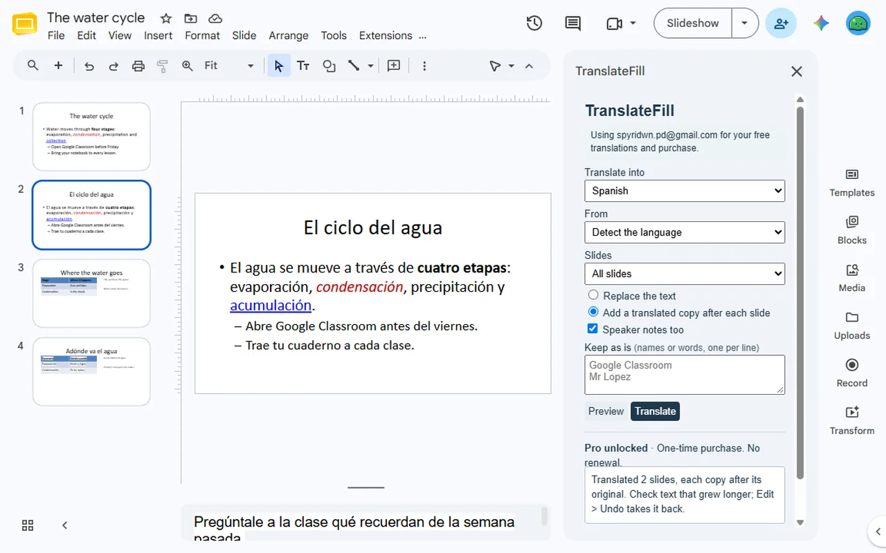
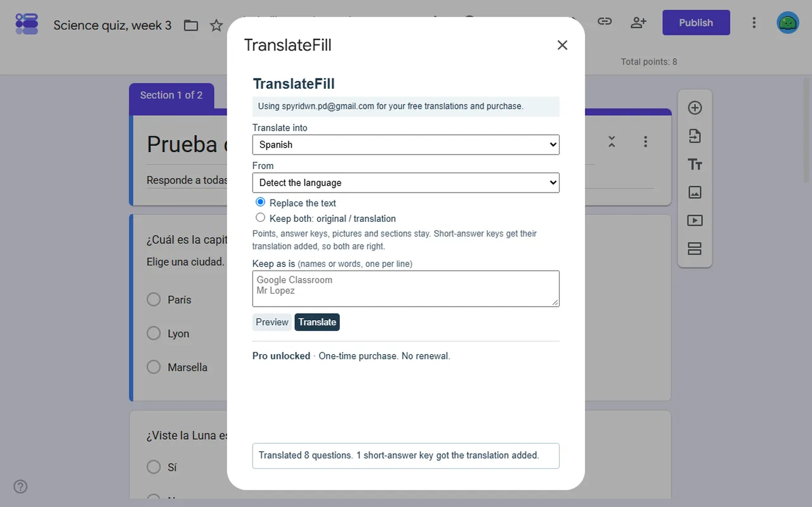
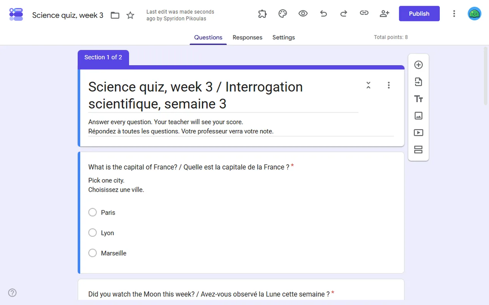

<a href="/addons/">Workspace add-ons</a>

<h1>TranslateFill: Translate for Forms™ Quiz &amp; Slides™</h1>

Translate in place for Google Slides™ and Google Forms™, formatting kept: quiz answer keys, points and pictures still work. Bilingual copies. 10 free, then $9 once.

Pro $9.00 once<a class="buy" href="https://workspace.google.com/marketplace/app/translatefill_translate_for_forms_quiz_s/275424614126">Install free</a>

<a href="/privacy/translatefill/">Privacy policy</a> &middot; <a href="/terms/translatefill/">Terms of service</a> &middot; Support: <a href="mailto:spyridwn.pd@gmail.com">spyridwn.pd@gmail.com</a>

TranslateFill translates a whole Google Slides™ presentation or Google Forms™ quiz in place, and
keeps what a copy-and-paste through a translator loses.

- **Formatting kept**: bold, italic, colours, fonts and links stay on the words they belong to,
  even when the translation puts them in another order. Text in boxes, groups, tables and speaker
  notes is translated.
- **Quizzes still work**: answer keys, points, feedback, section jumps and pictures on choices are
  kept. Short-answer keys get the translation added, so both the original and the translated
  answer are marked right.
- **Bilingual copies**: put a translated copy after each slide, or keep a form's original beside
  each translation.
- **Words left as they are**: names, brands and terms you list are never translated.
- **A free preview** of the translation before anything changes.
- **Narrow access**: TranslateFill reaches only the presentation or form you open it in, and a
  form once you choose it in Google's file picker. The text is translated by Google's own
  translation service.

## Plans

- **Free**: 10 slides or form questions in total per Google account. Previewing is always free.
- **TranslateFill**: $9 once per Google account for unlimited translation. No subscription.
  Refunds within 14 days. See the [terms](/terms/translatefill/).

**[Install free](https://workspace.google.com/marketplace/app/translatefill_translate_for_forms_quiz_s/275424614126)**

Open it from **Extensions > TranslateFill** in a presentation, or from the **Add-ons** button in a
form.

[Add-on will not open or uses the wrong Google account?](/google-workspace-add-on-wrong-account/)

Google Slides™ and Google Forms™ are trademarks of Google LLC. TranslateFill is not affiliated with
Google.

[Privacy policy](/privacy/translatefill/) · [Terms of service](/terms/translatefill/) ·
Support: [spyridwn.pd@gmail.com](mailto:spyridwn.pd@gmail.com)
