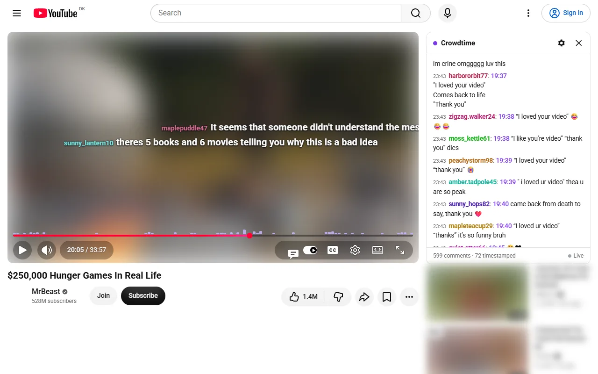
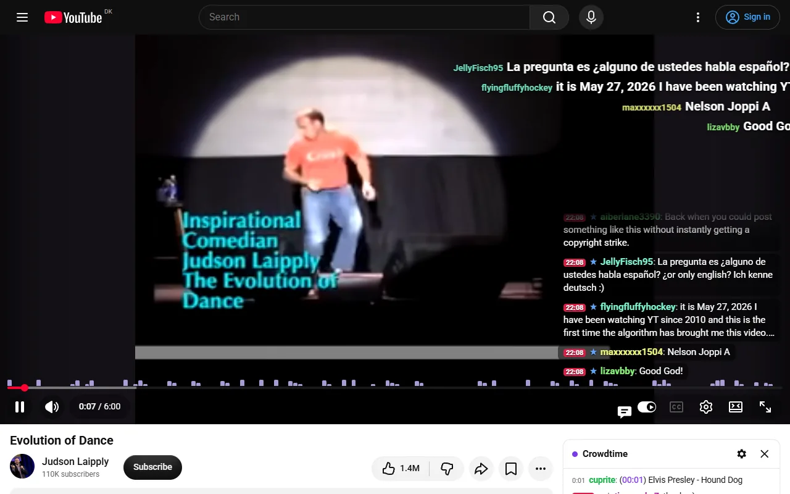
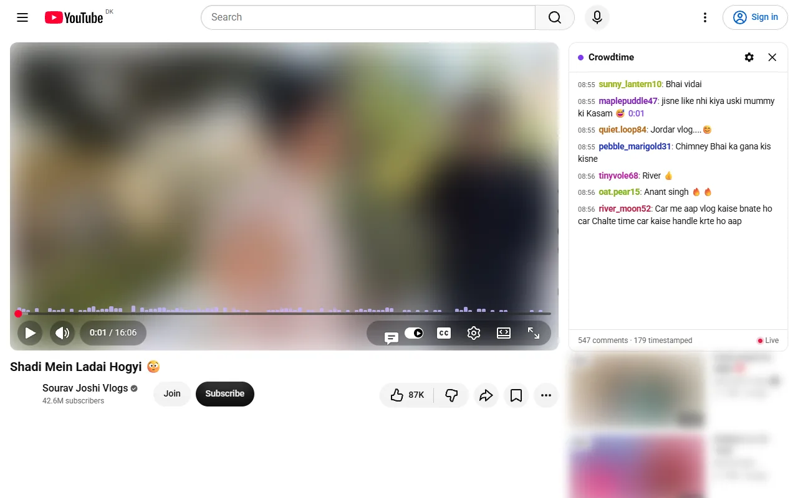
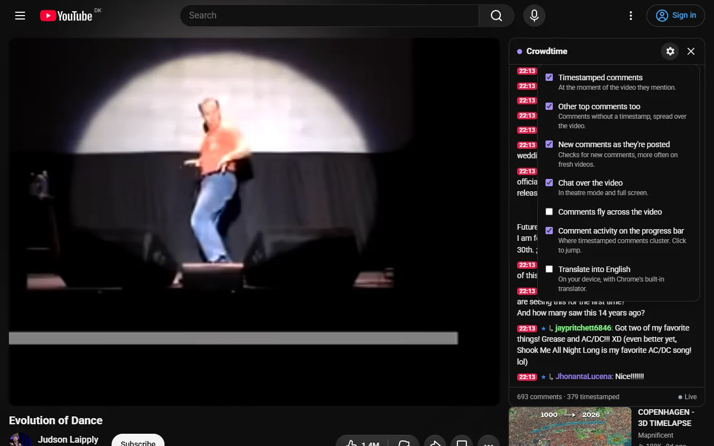

<a href="/extensions/">Chrome extensions</a>

<h1>Crowdtime: YouTube Comments as Live Chat</h1>

Read YouTube comments while watching, in a sidebar like a Twitch chat: timestamp comments at their moment, new ones in real time.

Free<a class="buy" href="https://chromewebstore.google.com/detail/crowdtime-youtube-comment/pocfkgkplocdholjidaikoodpgpincbf">Add to Chrome</a>

<a href="/privacy/ytchat/">Privacy policy</a> &middot; <a href="/terms/ytchat/">Terms of service</a> &middot; Support: <a href="mailto:spyridwn.pd@gmail.com">spyridwn.pd@gmail.com</a>

Watch a YouTube video's comments the way you'd watch a live chat. Crowdtime is available free
from the Chrome Web Store.

A panel beside the video shows its comments as a chat. A comment that mentions a moment, like
"2:41 the drop!", appears when the video reaches 2:41, and a comment listing several moments plays
line by line. Other top comments drift by in between, marked with a star, and on recent videos
new comments arrive while you watch, each with the time it was posted. Each kind can be switched
off in the settings. The replay pauses with the video and follows its speed; new comments keep
coming within seconds, and what is shown stays when you skip. Click a timestamp to jump there; jump
anywhere and every timestamped comment up to that moment is in the chat.

A thin strip above the progress bar shows where the comments cluster; click it to jump to the
busy moments. Comments fly across the picture at random heights, on by default, and in theatre
mode and fullscreen the chat sits over the edge of the video. Where Chrome offers its built-in translation, comments in
other languages can be shown in yours, translated on your computer.

There is no account and no server of ours: comments are read from YouTube in your own tab, and
your settings stay in your browser. On very large videos the chat reads the top 500 comment
threads and their replies.

Crowdtime is free: every feature, on every video, with nothing to buy.

Crowdtime is not affiliated with YouTube, Google, Twitch, MrBeast, IShowSpeed or Sourav Joshi Vlogs.

[Terms](/terms/ytchat/) · [Privacy policy](/privacy/ytchat/).
Support: [spyridwn.pd@gmail.com](mailto:spyridwn.pd@gmail.com).

Guides: [How to read YouTube comments while watching](/ytchat/read-youtube-comments-while-watching/) · [How to see YouTube timestamp comments at their moment](/ytchat/youtube-timestamp-comments/)
